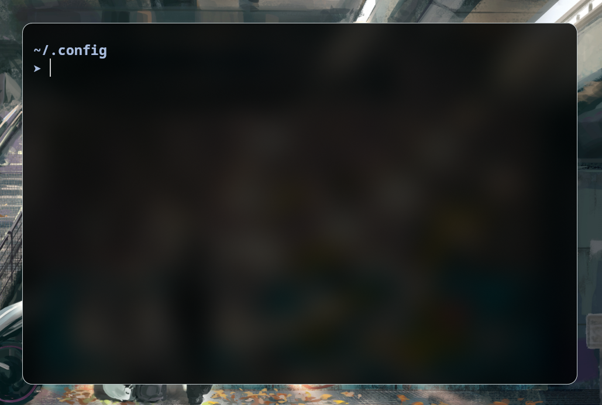
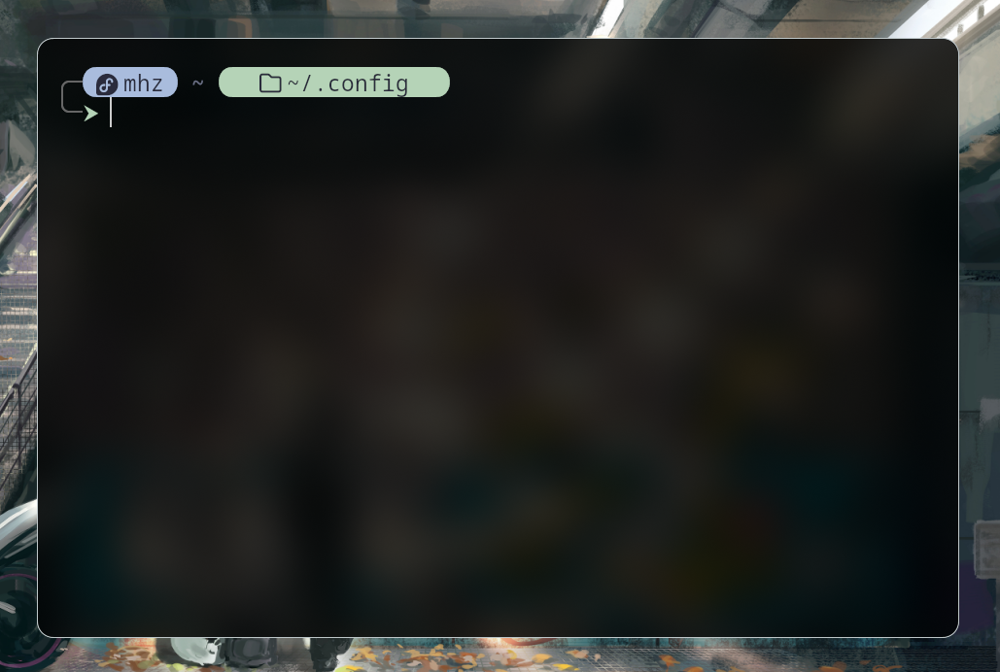

# starship-config

Two [starship](https://starship.rs/) configs in soft pastel colors: a **minimal** one (path only) and an **"islands"** one (rounded pills with the distro logo, username, path and git branch).

**Navigation:** [Configs](#configs) · [Requirements](#requirements) · [Customization](#customization) · [Compatibility](#compatibility) · [License](#license)

## Configs

### `starship-minimal.toml`

Just the path and an arrow, no frame, no pills. Long paths are shortened to the last three folders.

### `starship-pills.toml`

A `╭─ ╰─` frame, an island with the distro logo and username, and an island with the path. Inside a git repository an island with the branch is added.

## Requirements

- [starship](https://starship.rs/), recent enough to have the `os` module
- A Nerd Font, e.g. [JetBrainsMono Nerd Font](https://www.nerdfonts.com/)

## Customization

Main colors:

| Color     | Where                                                                                |
|-----------|--------------------------------------------------------------------------------------|
| `#A9BCDD` | Pastel blue: the username island (starship-pills), path and arrow (starship-minimal) |
| `#B5D3B7` | Pastel green: path, git branch and arrow (starship-pills)                            |
| `#E0A3B0` | Arrow after an error                                                                 |
| `#666666` | The `╭─ ╰─` frame                                                                    |
| `#6c7086` | The `~` separators between islands                                                   |
| `#2a2b3c` | Dark text on the pills                                                               |

What else you can tweak:

- `truncation_length` in `[directory]`: how many trailing folders to show, `0` means the full path
- `read_only` in `[directory]`: lock icon for folders without write permission
- Gap between islands: `[ ~ ]` at the start of `format` in `[directory]` and `[git_branch]`. Remove the spaces to make the gap smaller

## Compatibility

Tested on Fedora in kitty. On other systems and terminals it may look slightly different.

- The `⮞` arrow is missing from some fonts. If you don't see it, replace it with `➤` (as in the minimal config) or `❯`.
- An unknown distro gets the generic Linux icon. You can add your own logo to `[os.symbols]`; the name comes from the [starship docs](https://starship.rs/config/#operating-system).

## License

MIT
